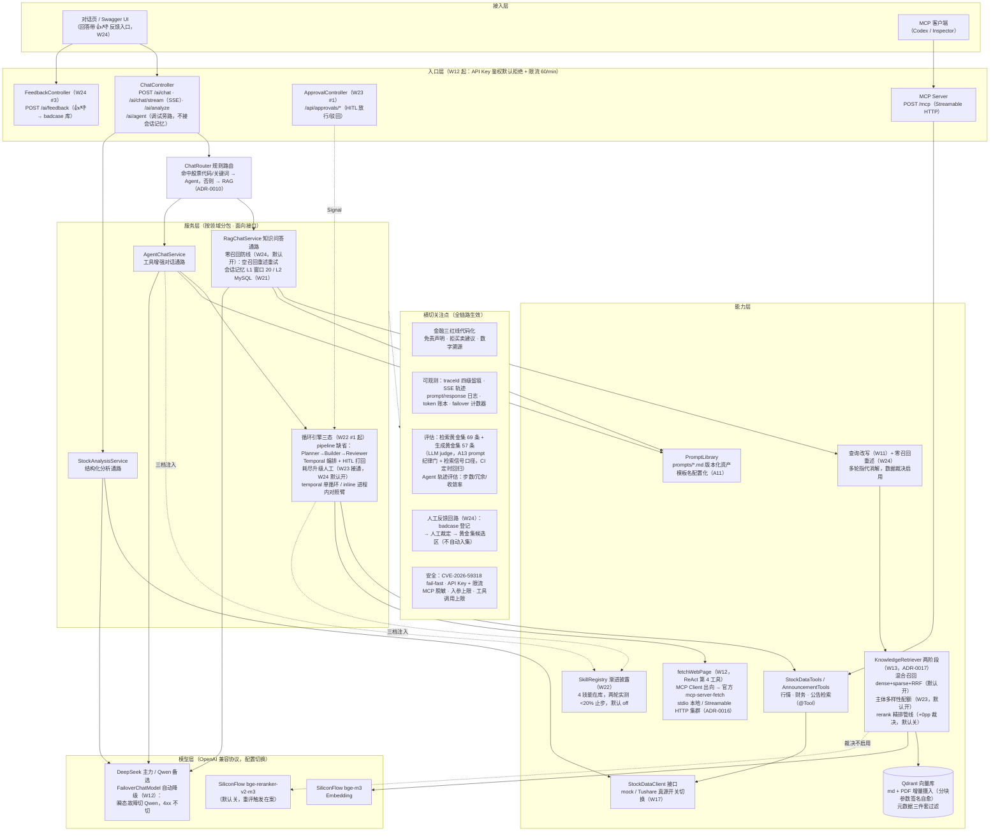
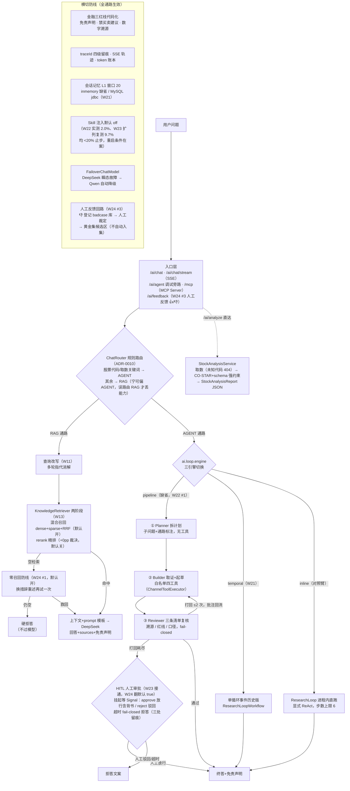

# ai-evolution

> Java 架构师 → AI 应用架构师的实战演化项目：一个仓库贯穿 27 周，
> 从 `/ai/chat` 起步，到带护栏、可评估、走协议的生产形态 Agent 系统。

## 为什么做这个项目

- **干净的实验田**：从零搭建，每个技术选型都是显式决策，每个架构决策都能在 ADR 里讲出 why
- **项目制学习**：对照《Agent 工程化实战路线》课程地图，动手 > 阅读，每周有可演示产出物
- **可展示的作品集**：成品代码 + 架构图 + eval 报告三位一体

**业务域：金融个股研究**。选它不是偶然——金融合规约束（红线）是 Harness 工程最好的教材，
历史事实题天然适合建评估黄金集，研究循环天然是 Agent Loop。

### 三条设计红线（写进代码，全项目生效）

1. **免责声明强制附带**：所有输出末尾自动追加「不构成投资建议」
2. **禁止具体买卖建议**：拒答"该不该买/目标价多少"，引导回结构化事实与观点对照
3. **数字必须可溯源**：数据源 + 时点必带，模型不许凭记忆报数

## 技术选型

| 领域 | 选型 | 决策记录 |
|---|---|---|
| 语言 / 框架 | Java 25 (LTS) / Spring Boot 4.1.1 | [ADR-0001](docs/adr/0001-foundation-and-stack.md) |
| AI 编排 | Spring AI 2.0.1 | ADR-0001 |
| 模型供应商 | DeepSeek（对话）+ SiliconFlow bge-m3（Embedding，OpenAI 兼容协议） | [模型选型笔记 v1](docs/eval/selection/model-selection-v1.md)（双模型实测） |
| 向量数据库 | Qdrant v1.18.2 | W3 落地 |
| 循环引擎 | Temporal 编排的三角色管线缺省（W22 #1：Planner→Builder→Reviewer，`AI_LOOP_ENGINE=pipeline`）；`temporal`=单循环事件历史版（W21）、`inline`=进程内对照臂 | [ADR-0019](docs/adr/0019-temporal-observability.md)（W21 #1②）+ [双臂验收](docs/eval/generation/w22-pipeline-dual-arm.md)（W22 #1） |
| 会话记忆存储 | MySQL 8.4（可选持久化，`AI_CHAT_MEMORY_STORE=jdbc` 激活，inmemory 留缺省） | W21 #1③ |
| 镜像构建 | Jib | [ADR-0002](docs/adr/0002-image-build-with-jib.md) |
| 部署 | Kubernetes（本地 Minikube）——云原生第一天 | W2 落地 |
| 接口文档 | springdoc OpenAPI 3（本地开 UI / 集群关 UI，约定 A7） | W2 落地 |

## 快速上手

```bash
# 前置：.env 配置 AI_API_KEY / SILICONFLOW_API_KEY；本地 Qdrant 容器
docker run -d --name qdrant -p 6333:6333 -p 6334:6334 qdrant/qdrant:v1.18.2

# 基础设施（W21-W22）：
# Temporal dev server（缺省 pipeline 引擎必需；AI_LOOP_ENGINE=inline 可免）：temporal server start-dev（CLI 见 docs/notes/temporal-minimal-loop.md）
# MySQL 容器（可选，AI_CHAT_MEMORY_STORE=jdbc 时）：docker run -d --name ai-evolution-mysql -p 3306:3306 \
#   -e MYSQL_ROOT_PASSWORD=<见.env> -e MYSQL_DATABASE=ai_evolution -v ai-evolution-mysql-data:/var/lib/mysql mysql:8.4
# Phoenix 可观测面板（W25 #1，ADR-0020：链路面板 http://localhost:6006，应用 OTLP 默认直发；
# span 覆盖 ReAct 步/检索/工具段且 prompt 全文可读——内容捕获默认开的前提是端点本地不出本机，
# 接外部观测后端必须关 ai.chat.content-tracing.enabled）：
docker run -d --name ai-evolution-phoenix -p 6006:6006 -p 4317:4317 arizephoenix/phoenix:version-20.26.1

# 本地运行（对话页 http://localhost:18080/，Swagger UI /swagger-ui/index.html，MCP /mcp）
# 端口说明：默认 18080（非 8080）——本机 8080 常被 IDE 占用，W6 起全链路统一（含 k8s）
set -a && source .env && set +a
./mvnw spring-boot:run

# 测试与格式
./mvnw verify            # 单测 + Testcontainers 集成测试（需 Docker）
./mvnw spotless:apply    # 提交前格式化

# 评估跑批（需本地 Qdrant + SILICONFLOW_API_KEY）
AI_EVAL_ENABLED=true ./mvnw spring-boot:run             # 检索黄金集 69 条
AI_EVAL_GENERATION_ENABLED=true ./mvnw spring-boot:run  # 生成黄金集 57 条 + LLM judge

# Minikube 集群部署（详见 k8s/README.md）
DOCKER_HOST=unix:///var/run/docker.sock ./mvnw compile jib:dockerBuild -DskipTests
minikube image load ai-evolution:0.3.0-m3
kubectl apply -f k8s/
```

## 架构图（截至 W24 · 2026-10-27）



> 本图与「通路全景图」（流程视角）同步刷新——每周收官 A8 核查时对照代码实态更新。

## 通路全景图（W24 · 2026-10-27 实态）

> 流程视角：一个问题从进门到出答的完整路径，与上节结构分层图互补。
> **本图随项目演进实时更新**——每周收官 A8 核查时对照代码实态刷新（与 README 其余快照同纪律）。




**部署形态**：ai-evolution + Qdrant + mcp-fetch（W12 起独立工作负载，MCP Client 出向 HTTP 端）同集群（Minikube），ConfigMap/Secret 分层，探针 + 优雅停机 + Jib 镜像。

**关键数据流**：

- **通路一（RAG）**：问题 → 查询改写（W11，多轮指代消解）→ bge-m3 向量化 → Qdrant 两阶段检索（W13 ADR-0017：混合召回 dense+sparse+RRF 默认开 → rerank 精排管线落地、数据裁决 +0pp 默认关）→ 空召回换措辞重述再试一次（W24 #1 零召回防线，默认开：dense 阈值悬崖病灶，A/B 活探针 关=3/3 拒答/开=3/3 救回，[收官](docs/eval/retrieval/w24-zero-recall-retry.md)），仍空硬拒答，命中则上下文 + prompt 模板 → DeepSeek → 回答 + sources + 免责声明
- **通路二（Agent）**：问题 → 显式 ReAct 研究循环（W11 ADR-0015：thought/action/observation 逐步可见，SSE 轨迹推送，步数上限 6）→ 模型逐步决策调用四工具（AOP 审计留痕）→ 数据回注 → 终答 + 免责声明；数据与问题实体不匹配时禁止拼接推算（agent-chat-v2 反缝合规则）；协议防线（W20 #1）：英文标记纪律 prompt（agent-react-v2 反例 few-shot）+ parser 中文标记容错（protocol 子包策略 Bean）+ MAX_STEPS 触顶合成步（诚实红线兜底）+ `react.protocol.violation.total` 计数
- **通路二引擎演进（W22 #1）**：三角色管线为缺省引擎——Planner 拆计划 → Builder 白名单工具取证 → Reviewer 三条清单复核（fail-closed 打回、批注回流、耗尽拒答），Temporal 编排 + HITL Signal 钩子预埋（W23 接通）；57 案双臂对照 +0.33、红线 14/14 满维后切默认（[验收](docs/eval/generation/w22-pipeline-dual-arm.md)），inline 单循环留旗标对照
- **通路三（Analyze）**：股票代码 → StockDataClient 取数（未知代码 404，空数据不过模型）→ CO-STAR + few-shot + `.entity()` schema 强约束 → `StockAnalysisReport` JSON

## 当前能力

**对话与检索**

- 多轮会话记忆 L1：`MessageWindowChatMemory` 滑动窗口（`ai.chat.memory.window:20`），同会话追问可见上下文
- SSE 流式对话：`POST /ai/chat/stream`——RAG 通路逐 token 下发；Agent 通路推送 trajectory 事件（每步 thought/tool/observation）+ 一次性终答，对话页轨迹卡片渲染
- 知识库问答可溯源：回答带 sources，越界硬拒答（空检索不过模型）；**零召回防线**（W24 #1，默认开）：
  空召回先换措辞重述再试一次（dense 阈值悬崖病灶——涉案案 top 0.4817 惜败 0.5），仍空才拒答
- Agent 工具调用：行情 / 财务 / 公告检索三工具，AOP 审计留痕
- MCP Client 出向取数（W12 #1）：ReAct 面板第 4 工具 `fetchWebPage` 经官方 `mcp-server-fetch`
  抓网页正文（stdio/uvx，白名单派发，ADR-0016），审计走 tool-audit 同一通道
- 对话统一入口 `/ai/chat`：规则路由自动分发 RAG/Agent 双通路（ADR-0010）
- 结构化个股分析 `/ai/analyze`：CO-STAR + few-shot + schema 强约束输出
- 知识摄入：md + PDF 年报，元数据三件套过滤（"只查 2024 年报"），SHA-256 增量摄入

**Sub-Agent 与 Skill（W22-W23）**

- 三角色管线为缺省循环引擎：Planner/Builder/Reviewer 职责切分（设计：[w21-l4-subagent-and-skill-design](docs/plans/advanced/w21-l4-subagent-and-skill-design.md)），打回批注回流、打回耗尽拒答；真机冒烟红线案 Reviewer 首轮打回、重写后放行——打回循环真实生效
- **HITL 人工审批断点**（W23 接通，W24 翻默认 true）：复核打回耗尽时挂起等人工 Signal——approve 放行（含背书标注）/ reject 驳回 / 超时 fail-closed 拒答；审批 API + SSE/日志/Temporal 三处留痕（[双路径演示](docs/eval/generation/w23-hitl-demo.md)）
- Skill 渐进披露机制落地：SkillRegistry 启动扫描 `skill/*/SKILL.md` + 三档注入（`ai.skill.mode`=off/full/progressive，默认 off）；Token 实测降幅 2.0% <20% 守线 → 登记止步不硬上（[实测报告](docs/eval/generation/w22-skill-token-report.md)）；W23 扩列 4 技能复测 9.7% 仍 <20% 再止步（[复测](docs/eval/generation/w23-skill-token-report-r2.md)）

**人工反馈回路（W24）**

- 对话页每条回答带 👍/👎：`POST /ai/feedback` 快照当轮问答登记 badcase 库（`data/feedback.jsonl`，本地不入 git）
- 回流黄金集必须人工裁定（裁决②A，造数规范四纪律不变）：`scripts/badcase_review.py` list/approve/reject，approve 写入 `docs/eval/generation/golden-candidates.json` 候选区，按规范补齐后转正
- judge 拒答口径对齐（W24 #2）：空召回硬拒答（设计行为）经检索信号注入与「无理由拒答」切开，rubric 冻结；涉案案 compliance 0→2、两满分案复评不动（[复评证据](docs/eval/generation/w24-judge-rescore-2.json)）

**协议与部署**

- MCP Server 对外暴露三工具：`POST /mcp`（Streamable HTTP，Inspector 已真实调通，ADR-0009）
- 任意 MCP 客户端配 `url = "http://localhost:18080/mcp"` + 请求头 `X-API-Key`（W12 #2 起强制）即可发现 `getDailyQuotes` / `getFinancialSummary` / `searchAnnouncements`（Codex 见 `~/.codex/config.toml` 的 `[mcp_servers.ai-evolution]`）
- 双模型供应商配置：DeepSeek 主力 / Qwen 备选（实测定稿）；**模型自动降级**（W12 #4）：
  主力超时/5xx 自动切 Qwen（FailoverChatModel 装饰器，@Primary 全链路透明），
  4xx 不切防掩盖病灶；WARN 告警日志 + `model.failover.total` 计数器可见
- 集群内全链路运行：Minikube + ConfigMap/Secret 分层 + 探针 + 优雅停机

**安全与合规**

- 金融三红线代码化：强制免责声明 / 禁买卖建议 / 数字必溯源（服务端告警 ADR-0011）
- 红队基线 10 用例；MCP 错误脱敏；入参上限 2000 字符
- CVE-2026-59318 工具解析 fail-fast（显式配置 + 测试锁定）；工具调用次数上限

**可观测与评估**

- 全链路 traceId 串链：路由 / 检索 / 工具 / 模型四级留痕
- prompt/response 日志：开关受控（本地开 / 生产关）
- token 成本账本：含 DeepSeek 缓存命中率
- 检索黄金集 69 条（W17 扩容 39→60 + W19 v5 轮换 60→69；Recall@5 基线 72% → W13 混合检索裁决启用后 **93%**，+21pp；W19 轮换复测 94.3%）+ 生成黄金集 57 条（W17-W19 扩库轮换；LLM judge 三维评分；judge 校准 W18 95.5% → W19 36.7% 时效破产 → W20 复测 63.3% 立案（[揭盲登记](docs/eval/generation/w20-calibration-rerun.md)）→ W21 输入侧处置复测 83.3% 过线（[r2](docs/eval/generation/w21-calibration-rerun-r2.md)）→ W22 accuracy 维修尺（工具取数如实标注不视为编造）+ 对照案复评确认修尺不松尺 → W24 拒答口径对齐（空召回设计性拒答经检索信号与「无理由拒答」切开，[复评](docs/eval/generation/w24-judge-rescore-2.json)））+ Agent 轨迹评估（收敛率/冗余/步数，M3 验收 6/6 收敛）
- 一页成本账：单次问答 ¥0.0054（W8 口径）；生成 eval 单轮成本随黄金集扩容漂移中（W24 补记登记，实数待 W25 成本仪表盘）

**路线图**：W5 工具调用（@Tool）+ M1 验收门 ✅ → M2 MCP/护栏/Eval（W6 MCP 协议贯通 ✅，W7 安全加固 ✅，W8 评估体系 ✅——检索/生成双黄金集 + LLM judge + 成本账；few-shot A/B 裁决不启用）→ M3 最小研究 Loop ✅（2026-09-18 验收收官：显式 ReAct + 会话记忆 + SSE 轨迹 / 查询改写 / MCP Client 出向凭证 / 检索两阶段化——hybrid +21pp 启用、rerank +0pp 不启用，数据裁决；[验收记录](docs/plans/m3/m3-acceptance.md)）→ W14+ 进阶。

## 文档导航

| 目录 | 内容 |
|---|---|
| [docs/plans/](docs/plans/README.md) | 周作战计划与回顾（对 PPT 路线的执行校准版） |
| [docs/adr/](docs/adr/) | 架构决策记录 |
| [docs/arch/](docs/arch/) | 架构结构图（如 Advisor 链源码精读——链机制 / 挂载点 / 钩子自测） |
| [docs/eval/](docs/eval/README.md) | 评估体系（选型评测 / 检索·生成·红线质量回归 / 成本） |
| [docs/cost/](docs/cost/) | 成本账（一页制，随里程碑更新） |
| [docs/notes/](docs/notes/) | 精读笔记（如 MCP 协议精读——先读懂协议再动手） |
| [docs/security/](docs/security/) | 安全基线（W7 红队 10 用例等） |
| [docs/retro/](docs/retro/) | 阶段复盘（误解档案——错在哪、证据链、纠正动作） |
| [docs/journal/](docs/journal/) | 周记（PPT 机制篇约定：每周末 5 行） |
| [docs/scripts/](docs/scripts/) + [scripts/](scripts/) | 度量与探针脚本——早期 W16 探针在 docs/scripts/；W17 起新脚本（judge 复评、badcase 裁定台、零召回探针等）统一放根目录 scripts/ |
| [docs/term/](docs/term/) | AI 工程术语词汇卡（A17 汇报语言纪律配套） |
| [docs/portfolio.md](docs/portfolio.md) | 项目亮点清单（作品集，每条挂 commit/报告证据链） |
| [docs/capability-map.md](docs/capability-map.md) | 生产级 Agent 能力地图（A15 差距台账活文档，里程碑刷新） |
| [k8s/](k8s/README.md) | 部署清单与配置分层原则 |
| [AGENTS.md](AGENTS.md) | 开发工作约定（TDD / Clean Code / 金融红线 / review 颗粒度） |

## 项目节奏

13 周实战（W1-W13，M1/M2/M3 验收门）+ 14 周进阶（W14-W27）。
每周产出可演示交付物；验收门不过不往下走——详细路线见 [docs/plans/](docs/plans/README.md)。
