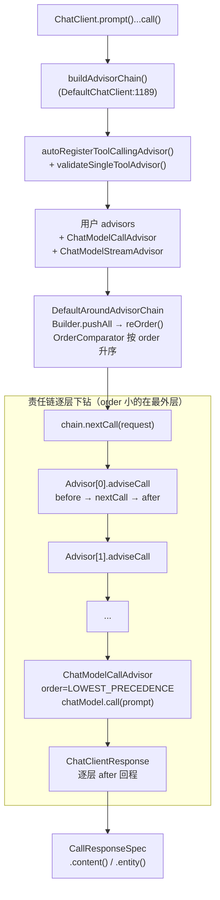

# Advisor 链源码精读（Spring AI 2.0.1）

> W20 #3 专项一主菜产出。源码依据：`spring-ai-client-chat-2.0.1-sources.jar`（本地
> ~/.m2）+ `advisors/spring-ai-vector-store-advisor`（GitHub v2.0.1 tag，QuestionAnswerAdvisor
> 在 2.0 已迁出 client-chat 模块）。行号均按 2.0.1 sources 标注。

## 一句话总览

ChatClient 的 `call()`/`stream()` 并不直接调模型——它现场装配一条**按 order 排序的
Advisor 责任链**，请求像穿过洋葱一样逐层 `before` 进去，链尾 `ChatModelCallAdvisor`
真正调 `ChatModel.call()`，响应再逐层 `after` 出来；任何一层都可以改写请求/响应，
也可以**短路**（不调下一层直接返回）。

## 1. 调用链全景



要点：

- 链**每次调用现场构建**（`DefaultChatClient.java:1177` `call()` → `buildAdvisorChain()`），
  不是启动期固定——调用点 `.advisors()` 可以追加本次调用专属的 Advisor。
- `buildAdvisorChain()` 把两个**链尾 Advisor** 无条件追加到最后
  （`DefaultChatClient.java:1195-1197`）：`ChatModelCallAdvisor`（同步）与
  `ChatModelStreamAdvisor`（流式），order 均为 `Ordered.LOWEST_PRECEDENCE`。
- 装配前自动注册 `ToolCallingAdvisor`（order = `HIGHEST_PRECEDENCE + 300`），
  除非显式关闭或已存在别的 `ToolAdvisor`；全链**最多允许一个 ToolAdvisor**，
  否则启动即抛 `IllegalStateException`（`DefaultChatClient.java:1240-1248`）。

## 2. 链机制：DefaultAroundAdvisorChain（296 行）

| 机制 | 源码位置 | 说明 |
|---|---|---|
| 双队列 | `callAdvisors` / `streamAdvisors` 两个 `Deque` | 同步/流式各走各的链 |
| 排序 | `Builder.reOrder()`（:277） | `OrderComparator.sort`——**order 值小的排前面，先执行（最外层）** |
| 下钻 | `nextCall()`（:98-121） | `pop()` 出当前 Advisor → `advisor.adviseCall(request, this)`——把链**自身**传进去，Advisor 内部回调 `chain.nextCall()` 才继续往下 |
| 短路 | 同上 | Advisor 不调 `nextCall` 直接返回 = 短路，后续层与模型调用全部跳过 |
| 子链 | `copy(after)`（:169-195） | 取某 Advisor **之后**的剩余链——`ToolCallingAdvisor` 靠它在工具循环里反复重进链尾（`ToolCallingAdvisor.java:167`） |
| 观测 | 每层包一个 Micrometer `Observation`（:113-120） | span 名 = Advisor 名，顺序/异常自动留痕 |

**模式定性**：责任链（Chain of Responsibility）+ 装饰器（Decorator）的复合——每层
既决定"是否传给下一层"（责任链），又能在前后包裹增强逻辑（装饰器/AOP around）。
排序靠 Spring 祖传 `Ordered` 接口，与 Filter/Interceptor 体系同一套心智。

## 3. API 分层与 order 语义

```
Advisor (extends Ordered)          ← getName() + getOrder()
├── CallAdvisor                    ← adviseCall(request, CallAdvisorChain)
├── StreamAdvisor                  ← adviseStream(request, StreamAdvisorChain)
└── BaseAdvisor (实现以上两个)      ← 模板方法：before() → nextCall → after()
```

- `BaseAdvisor.adviseCall` 默认实现（`BaseAdvisor.java:47-54`）：
  `before(request)` → `chain.nextCall(加工后的 request)` → `after(response)`。
  **写普通增强型 Advisor 只需覆写 before/after 两个方法**。
- ⚠️ **BaseAdvisor 的 before 返回的是 Request，无法短路**——要做拦截型 Advisor
  （命中即拒答），必须像 `SafeGuardAdvisor` 一样直接实现 `CallAdvisor`/`StreamAdvisor`。
- order 语义（与 Spring 全家桶一致）：**值小 = 先进入 = 最外层**；响应回程逆序。
  关键刻度：
  - `SafeGuardAdvisor` 默认 `0`
  - `SimpleLoggerAdvisor` 默认 `0`
  - `QuestionAnswerAdvisor` 默认 `0`
  - 记忆 Advisor 专用刻度 `Advisor.DEFAULT_CHAT_MEMORY_PRECEDENCE_ORDER = HIGHEST_PRECEDENCE + 200`
  - `ToolCallingAdvisor.DEFAULT_ORDER = HIGHEST_PRECEDENCE + 300`（注释明确：让记忆
    Advisor 默认裹在工具循环**外面**，每轮工具迭代不重复注入历史）
  - 本项目 `TokenUsageAdvisor = LOWEST_PRECEDENCE - 1`（贴着链尾，拿到最终实际发往
    模型的请求）
  - 链尾 `ChatModelCallAdvisor = LOWEST_PRECEDENCE`
- 流式差异：`BaseAdvisor.adviseStream` 的 `after` 只在 `onFinishReason` 命中的那一帧
  执行（:68-73），且整个流被 `ChatClientMessageAggregator` 聚合以回填观测上下文。

## 4. 上下文载体：ChatClientRequest / ChatClientResponse

两个都是 record，结构对称：

```java
ChatClientRequest(Prompt prompt, Map<String, Object> context)
ChatClientResponse(ChatResponse chatResponse, Map<String, Object> context)
```

- `prompt` 是发给模型的本体；`context` 是**贯穿全链的数据总线**——Advisor 之间、
  Advisor 与调用方之间的传话通道。
- 三个实战用例：
  - `QuestionAnswerAdvisor.before` 把检索结果塞进 `context["qa_retrieved_documents"]`，
    `after` 再把它搬进响应 metadata——引用来源随响应透出；
  - 记忆 Advisor 从 `context` 取 `conversationId` 决定读哪份历史；
  - 结构化输出经 `context` 传 `OUTPUT_FORMAT`/`STRUCTURED_OUTPUT_SCHEMA`，链尾
    `ChatModelCallAdvisor.augmentWithFormatInstructions`（:66-101）织入 prompt。
- 不可变风格：改请求用 `request.mutate()....build()` 产出新实例，不在原地动。

## 5. 链尾：ChatModelCallAdvisor（136 行）

唯一职责：把 `ChatClientRequest` 变成一次真实模型调用。

1. `augmentWithFormatInstructions`：若 context 带输出格式/schema，拼进 user 消息
   （或走原生 structured output 选项）；
2. `chatModel.call(prompt)`；
3. 把 `ChatResponse` + context 包成 `ChatClientResponse` 回程。

`getName()` 返回 `"call"`，`getOrder()` 返回 `LOWEST_PRECEDENCE`——**它没有任何
before/after 业务语义，就是链的终点**。

## 6. 内置 Advisor 挂载点速查

| Advisor | order | 机制 | 干什么 |
|---|---|---|---|
| `SafeGuardAdvisor` | 0 | **直接实现 Call/StreamAdvisor，短路** | 敏感词命中 → 构造失败响应直接返回，不调 `nextCall`（越界拦截参照系） |
| `SimpleLoggerAdvisor` | 0 | before 记请求 / after 记响应 | DEBUG 级请求响应日志 |
| `MessageChatMemoryAdvisor` | +200（记忆刻度） | BaseAdvisor | before 取历史前插 + SystemMessage 置顶 + 写入本轮 user 消息 |
| `QuestionAnswerAdvisor`（RAG） | 0 | BaseAdvisor | before 向量检索→模板注入 user 消息 + 结果入 context；after 结果入响应 metadata |
| `ToolCallingAdvisor`（2.0 新） | +300 | 递归 Advisor | 把工具调用循环搬进链内：`copy(this)` 取子链 do-while 重进，其余 Advisor 能拦截每一轮工具迭代 |

## 7. 本项目实际挂载（ai-evolution 现状）

| 挂载点 | 位置 | 说明 |
|---|---|---|
| `TokenUsageAdvisor` | `ModelObservabilityConfig` → `ChatClientCustomizer` 全局织入 | W7：所有 ChatClient 统一记 token 账，order=LOWEST-1 贴链尾 |
| `SimpleLoggerAdvisor` | 同上 | W8-6：DEBUG 开关 + MDC traceId |
| `MessageChatMemoryAdvisor` | `RagChatService` 调用点 `.defaultAdvisors(...)` | RAG 通路的会话记忆 |
| ~~记忆 Advisor~~（Agent 通路） | `AgentChatService` **手工读写** | 原 advisor 在 ReAct 循环每步重复追加同一条 user 消息，弃用改手工 |
| ~~QuestionAnswerAdvisor~~（RAG 通路） | **不用，手动编排** | 引用来源必须随响应返回（金融红线三）+ 检索为空直接拒答的防幻觉闸门，黑盒 Advisor 满足不了 |

## 8. 钩子自测问答

**Q1（蓝图验收题）：加一层自定义越界拦截，钩子在哪？**

> 写一个类**直接实现 `CallAdvisor`（需要流式再加 `StreamAdvisor`）**，
> `adviseCall` 里先检查 `chatClientRequest.prompt()`：命中越界 → 构造
> `ChatClientResponse` 直接返回，**不调 `chain.nextCall()`**（短路，模型根本不被
> 调用）；未命中 → `return chain.nextCall(request)` 放行。
> `getOrder()` 给小值（参照 `SafeGuardAdvisor` 默认 `0`）确保排在链前段、记忆/RAG
> 增强之前。注册两条路：全局用 `ChatClientCustomizer`（`builder.defaultAdvisors(...)`，
> 本项目 `ModelObservabilityConfig` 现成先例）；单次调用用调用点 `.advisors(...)`。
> 参照实现：`SafeGuardAdvisor`（156 行）就是官方范本。

**Q2：为什么不能用 BaseAdvisor 写越界拦截？**

> `BaseAdvisor.before()` 的返回类型是 `ChatClientRequest`——模板方法拿到 before 的
> 返回值后**无条件**调 `chain.nextCall()`，没有"不往下走"的出口。拦截必须自己控制
> 是否调用 nextCall，所以要直接实现 `CallAdvisor`。（`SafeGuardAdvisor` 正是因此
> 没用 BaseAdvisor。）

**Q3：想让某增强在每轮工具调用迭代里都生效，怎么排？**

> 把 order 排到 `ToolCallingAdvisor`（+300）**之后**（值更大）——它会在工具循环
> 内部被反复经过（`ToolCallingAdvisor` 用 `chain.copy(this)` 重进子链）。反之排到
> +300 之前则只在整个工具循环外层执行一次。记忆 Advisor 默认 +200 就是故意排在
> 循环外，避免每轮重复注入历史。

**Q4：Advisor 之间怎么传数据？**

> `ChatClientRequest.context` 这个 Map 是全链数据总线。写方在 before 里
> `request.mutate().context(key, value).build()`，读方在 after 或后续层从
> `response.context()` 取。官方键命名习惯带前缀（如 `qa_retrieved_documents`）防撞名。
