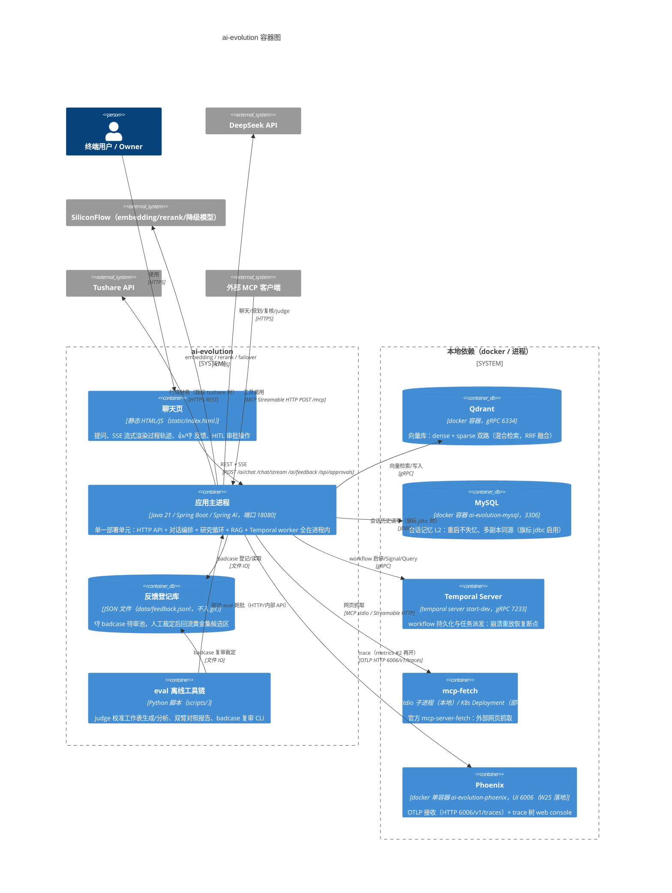

# C4 L2：容器图（Container）

> C4 第二级：系统内部的「可部署/可运行单元」。视角问题：**系统由哪些进程/存储组成，
> 各自的技术选型和职责是什么？** 截止 2026-10-29（W25 #1b Phoenix 落地）。

## 读图要点

- **单进程内核**：应用主进程是唯一业务计算单元——三角色管线的「sub agent」是进程内
  角色隔离（接口+prompt+Temporal 编排），不是多进程（参见 loop 组件图）。
- **部署形态双 profile**（application.yml 尾部）：本地 default=stdio 拉起 mcp-fetch
  子进程；K8s profile=Streamable HTTP 连独立 mcp-fetch Service（契约不变式，上层零感知）。
- **K8s 清单**（`k8s/`）：应用 Deployment/Service/ConfigMap + qdrant + mcp-fetch
  （含 NetworkPolicy）；MySQL/Temporal 当前仅本地容器，未入 K8s 清单。
- **旗标化外部依赖**：记忆仓储（inmemory/jdbc）、股票数据源（mock/tushare）、
  循环引擎（pipeline/temporal/inline）、sparse 实现（matchtext/bm25）、rerank/hybrid/
  diversity/zero-recall-retry——全部配置裁决，多数经黄金集数据裁决定档（见课程地图触发点清单）。
