# C4 L3：组件图 · chat 对话入口域

> C4 第三级：主进程内部的组件拆分。本张聚焦 **chat 包 + 入口层**——请求怎么进来、
> 怎么分流、记忆在哪挂载。截止 2026-10-28（W24 收官态）。

```mermaid
C4Component
  title 组件图：chat 对话入口域（com.aievolution.chat）

  Person(user, "用户/审批人")

  Container_Boundary(app, "ai-evolution 主进程") {
    Component(secfilter, "ApiKeyAuthFilter + RateLimit", "Spring Security", "X-API-Key 鉴权（空值启动 fail-fast）；固定窗口限流 60/min/身份")
    Component(tracefilter, "TraceIdFilter", "Servlet Filter", "生成/透传 traceId 写 MDC——日志四面同键的起点")
    Component(chatctl, "ChatController", "@RestController /ai", "POST /chat 同步、/chat/stream SSE 流式、/agent 显式旁路")
    Component(anactl, "AnalysisController", "@RestController /ai", "POST /analyze 个股分析报告（独立通路）")
    Component(approvalctl, "ApprovalController", "@RestController /api/approvals", "HITL：查询挂起状态 / 提交 approve|reject Signal")
    Component(feedbackctl, "FeedbackController", "@RestController /ai/feedback", "👍/👎 登记，👎 入待审池")
    Component(router, "ChatRouter", "规则路由", "命中股票代码/关键词（股价/行情/营收…）→ Agent 通路；其余 → RAG 通路")
    Component(ragchat, "RagChatService", "对话服务", "RAG 管道：改写→检索→生成→引用校验；零召回重试防线")
    Component(agentchat, "AgentChatService", "对话服务", "工具管道：@Tool 直通 + 研究循环入口")
    Component(memoryadv, "MessageChatMemoryAdvisor", "Spring AI Advisor", "会话记忆定点挂载（仅对话域，eval/judge 不共享防污染）")
    Component(analysissvc, "StockAnalysisService", "分析服务", "结构化财报分析（独立于对话域，无记忆）")

    Component_Ext(loopengine, "ResearchLoopEngine", "loop 域", "研究循环引擎（pipeline/temporal/inline 三态旗标）")
    Component_Ext(retriever, "KnowledgeRetriever", "rag 域", "两阶段混合检索")
    Component_Ext(memory, "ChatMemory（MessageWindow，窗口 20）", "infra 域", "inmemory / jdbc-MySQL 双仓储旗标")
    Component_Ext(feedbackstore, "FeedbackStore", "feedback 域", "JSON 文件登记库（data/feedback.jsonl）")
    Component_Ext(promptlib, "PromptLibrary", "prompt 域", "classpath prompt 模板版本化资产")
  }

  Rel(user, secfilter, "HTTPS", "X-API-Key")
  Rel(secfilter, tracefilter, "过滤链")
  Rel(tracefilter, chatctl, "/ai/*")
  Rel(tracefilter, anactl, "/ai/analyze")
  Rel(tracefilter, approvalctl, "/api/approvals/*")
  Rel(tracefilter, feedbackctl, "/ai/feedback")

  Rel(chatctl, router, "分流")
  Rel(router, ragchat, "知识问答")
  Rel(router, agentchat, "股价/行情/财务类")
  Rel(ragchat, memoryadv, "经 Advisor 链")
  Rel(agentchat, memoryadv, "经 Advisor 链")
  Rel(memoryadv, memory, "按 conversationId 隔离读写")
  Rel(ragchat, retriever, "检索增强")
  Rel(agentchat, loopengine, "研究循环（含 HITL 挂起）")
  Rel(approvalctl, loopengine, "Signal: approve/reject")
  Rel(ragchat, promptlib, "rag-chat-v3 等模板")
  Rel(feedbackctl, feedbackstore, "登记")
```

## 读图要点

- **统一入口 + 规则路由**（ADR-0010）：`/ai/chat` 单入口，ChatRouter 按关键词分流；
  `/ai/agent` 保留为显式旁路（调试/对照用）。
- **记忆刻意不全局挂载**：只有 RagChatService/AgentChatService 构造器挂
  MessageChatMemoryAdvisor——分析服务与 eval judge 共享 ChatClient 但不共享记忆，
  防评分尺度被会话污染。
- **SSE 流式**是轨迹通道：管线每一步（plan/build/review/HITL 挂起）经 SSE 推到页面，
  W11 起「循环搬到明面」的载体。
- **HITL 双端点**：loop 内挂起（Workflow.await）↔ ApprovalController 发 Signal，
  超时 fail-closed 拒答（W23/W24）。
