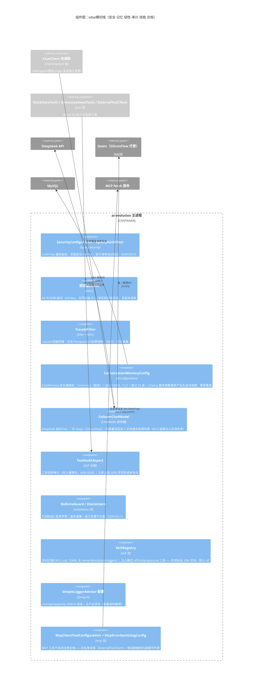

# C4 L3：组件图 · infra 横切域

> 本张聚焦 **横切关注点**——不属于任何单一业务域、但每个请求都穿过的组件：
> 安全、记忆、模型韧性、审计、技能、合规。截止 2026-10-28（W24 收官态）。

## 读图要点

- **failover 是所有模型调用的唯一咽喉**：重试压到 2 次（库默认 10 次会把供应商故障
  拖成十分钟级挂起——W12 故障注入实测抓获），快速失败后切备用臂；降级期延迟
  30-60x，靠告警日志+计数器可见。
- **记忆配置的刻意手工**：DataSource 自动配置显式排除，jdbc 模式手工装配——
  保证 inmemory 缺省态零 DataSource 副作用，换库只动配置不动代码。
- **安全三层的分工**：入口鉴权限流（sec/ratelimit）→ 工具边界（audit/白名单/入参上限）
  → 内容合规（redline 告警）。「看得见先于拦得住」（W7 原则）。
- **Skill 机制是「止步」样板**：机制造好了、双臂实测 2.0%/9.7% 均未达 20% 守线，
  默认 off 登记挂账——能力具备但不启用，等重评触发条件（W25 #3 模型路由可能改变格局）。
