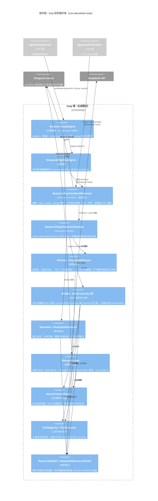

# C4 L3：组件图 · loop 研究循环域

> 本张聚焦 **loop 包**——三角色管线（sub agent）怎么编排、Temporal 在哪一层、
> HITL 断点怎么挂。截止 2026-10-28（W24 收官态，engine 缺省=pipeline）。

## 读图要点

- **「sub agent」的真身**：Planner/Builder/Reviewer 是三个 Java 接口 + 三套专属 prompt
  + 收窄的输入输出契约，背后是同一个 DeepSeek 模型；角色隔离的价值在**上下文隔离**
  （Reviewer 只拿到草稿成品，不见 Builder 推理过程），不在进程隔离。
- **workflow/activity 分层是 Temporal 纪律**：workflow（编排）必须确定性——只用入参、
  activity 返回值、Workflow API；一切副作用（LLM 调用、日志留痕）都在 activity 层。
  进程崩溃后 Temporal 按事件历史重放恢复断点。
- **打回回路**：review 打回 ≤2 次，批注回流 Builder 重写；耗尽后两条路——拒答文案
  （宁可不答不可错答）或 HITL 挂起等人工（默认开，超时 fail-closed）。
- **重试策略分层**：plan/review 快活动（120s 超时、attempts=2）；build 含多轮模型+工具
  调用放宽到 600s。
- **三引擎旗标**：pipeline 缺省（W22 双臂验收 +0.33 且红线满维后切默认）；temporal=
  单循环事件历史版；inline=进程内直跑，留作 A/B 对照臂。
