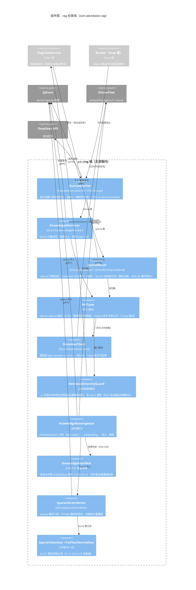

# C4 L3：组件图 · rag 检索域

> 本张聚焦 **rag 包**——摄入侧（写入）与检索侧（读出）两条链，以及每个数据裁决
> 过的开关在哪。截止 2026-10-28（W24 收官态）。

## 读图要点

- **两阶段范式**（ADR-0017）：宽松召回（topK=20）→ 融合/精排 → 截断（top-k=5）；
  线上与 eval 共用同一份配置（application.yml `ai.rag.*`），保证「评估口径=线上口径」。
- **每个开关都有裁决报告**：hybrid +21pp 开、rerank +0pp 关、diversity 双证据达标开、
  zero-recall-retry A/B 探针开——翻旗标的姿势全部是黄金集数据（课程地图触发点清单）。
- **阈值悬崖病灶坐标**：dense 阈值 0.5 在 retriever 组件内——W24 涉案案 top 0.4817
  惜败于此，重试防线挂在 RagChatService（域外），治本留给 W25 #4。
- **摄入=写入签名联动**：sparse impl 切换并入向量签名判变键，换实现触发全量重建，
  不会半新半旧混存。
