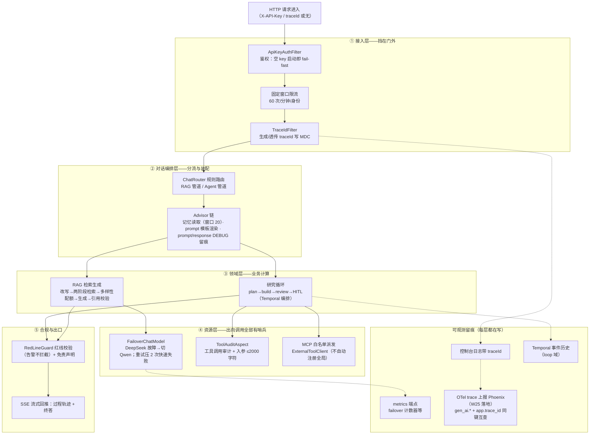

# 横切视图：一次请求穿过的关注点分层

> 补充视图（非 C4 静态层级）：任何一个 HTTP 请求从进来到出去，依次穿过哪些横切层、
> 每层由哪个组件把守、在哪留痕。读法：**自上而下是请求流向，右侧是每层挂载的横切关注点**。
> 截止 2026-10-29（W25 #1b Phoenix 落地）。

## 每层一句话

| 层 | 把守者 | 记忆点 |
|---|---|---|
| ① 接入 | 鉴权/限流/traceId | 鉴权没有「忘记开」的静默中间态——空 key 直接启动失败（ADR-0013） |
| ② 编排 | ChatRouter + Advisor 链 | 记忆定点挂载：只有对话域挂，eval/judge 不共享（防污染） |
| ③ 领域 | RAG / Loop | 业务层不含安全与留痕代码——全在横切层 |
| ④ 资源 | Failover / 审计 / 白名单 | 所有出向调用都有哨兵：模型有 failover、工具有审计、MCP 有白名单 |
| ⑤ 出口 | 红线 + SSE | 「看得见先于拦得住」（W7）：第一版红线只告警 |

## 横切关注点的归属速查

- **安全**：① 鉴权限流 + ④ 工具边界 + ⑤ 内容合规（三层纵深）
- **可观测**：traceId 四面同键（日志/Temporal UI/反馈快照/W25 OTel 链路）
- **成本**：token 账（W7 TokenUsageAdvisor → W8 一页账 → W25 JSONL 台账 + 仪表盘端点 + 预算熔断）
- **韧性**：failover 快速失败 + Temporal 崩溃重放 + manifest 损坏自愈
