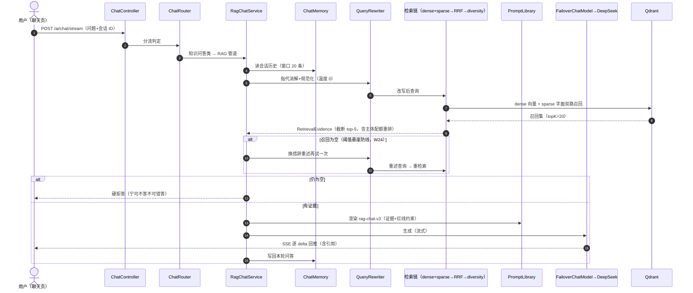
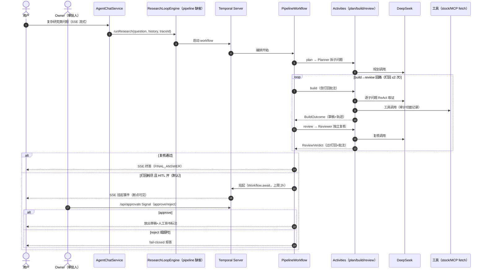
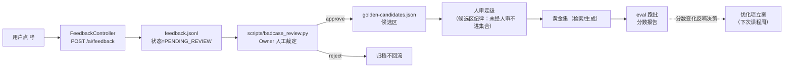
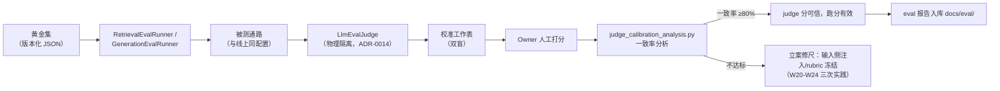

# 纵切视图：四条端到端业务链路

> 补充视图（非 C4 静态层级）：挑四条最有代表性的业务链路，从用户动作一路画到外部依赖
> 再画回来——每条链路纵穿所有域。读法：**一条链路就是一次完整的「竖切片」**。
> 截止 2026-10-28（W24 收官态）。

## 纵切①：RAG 知识问答链路（/ai/chat 主流通路）

**关键坐标**：阈值 0.5 悬崖在检索链内（W24 病灶）；零召回重试挂在 RagChatService；
引用校验+红线在生成后出口侧。

## 纵切②：研究循环链路（Agent 通路，含 HITL）

**关键坐标**：workflow 只编排不碰副作用；崩溃后 Temporal 按事件历史重放续跑；
HITL 缺席策略显式化——超时未决往「拒答」倒（W23/W24）。

## 纵切③：人工反馈闭环链路（👎 → 黄金集候选）

**关键坐标**：反馈入集必过人（W24 裁决②A）；候选区与正式集物理隔离；
真实 badcase 694fcbe6 已走通全程（W24 #3）。

## 纵切④：eval 离线评估链路（尺子自身的生产线）

**关键坐标**：judge 与被测通路物理隔离（不共享记忆/配置）；校准证据有保质期——
语料轮换或缺陷修复后必须复测（retro #3/#4，规范第五条）。

## 四条链路的共同模式

每条纵切都遵循同一个骨架：**入口留痕（traceId）→ 域内计算 → 出口校验 → 留痕回流**。
差异只在域内计算的形态（一次性检索 / 多轮循环 / 文件异步 / 离线跑批）。
新链路设计时照此骨架自检：入口有没有 traceId？出口有没有校验？留痕写到哪？
