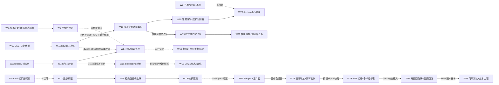

# 课程地图：W1-W24 全景串联（v3 学习资产版）

> 2026-10-28 改版（v3：在 v2 导航骨架上增加学习资产视角——逐周「学了什么 / 关键技术 /
> 记忆点 / 产物链接」四要素，产物链接补全 ADR、课程笔记、eval 报告三类证据）。
> 数据源头：各周计划与回顾文档原文 + 蓝图 [blueprint/README.md](blueprint/README.md)，
> 冲突时以周计划为准（蓝图 §0 口径）。
>
> **维护规则（防腐化，同构于黄金集轮换纪律）**：每周收官时在本表加一行并刷新"当前位置"
> 与"决策触发点"状态，挂进周记 15 分钟机制；超过两周未更新视为失效，重读各周计划重建。
>
> **关系标签**：←承 = 输入来自哪周 ｜ →启 = 输出供给哪周 ｜ ⚓伏笔 = 当时无意、后世兑现 ｜
> 📌挂账 = 未决项的流向。能力坐标（L0-L4 × 会用/会调/会造）另见
> [capability-map](../capability-map.md)，本表不再重复。

## 全局产物速查（先记住这五个入口）

| 入口 | 内容 |
|---|---|
| [能力地图](../capability-map.md) | 每项能力的 会用/会调/会造 坐标与状态 |
| [retro 文集](../retro/w14-w24-misconceptions.md) | 23 条误解实证 + 黄金集合方法论四命题——本课程最稠密的记忆点集合 |
| [ADR 列表](../adr/) | 20 张架构决策卡：每个「为什么这么选」的原始裁决 |
| [eval 索引](../eval/README.md) | 检索/生成两类评估报告的全部入口 |
| [术语表](../term/terminology.md) | 课程术语统一定义 |

## 一句话主线 与 当前位置

**从"能跑"到"可信"**：W1-5 把系统立起来（地基→模型→RAG→Prompt→工具），W6-9 让它
安全可测（协议→安全→评估→验收），W10-13 让它自己转（记忆→Loop→双向凭证→检索攻坚），
W14-19 把"可信"做成体系（复盘清账→检索收尾→评估造数→轮换首演），W20-24 把"可信"
推进到生产形态（泄漏修复→Temporal 韧性→三角色管线→HITL→反馈回路）。

**当前位置：W24 ✅ 已收官 → W25 ▶ 已立案五件**（#1 可观测性 web console 已裁决
ADR-0020：OTel GenAI 埋点 + Phoenix 先行；#2 成本仪表盘+预算熔断；#3 模型路由；
#4 bm25 重评；#5 反馈回路最后一公里——见 [W25 计划](advanced/w25-cost-engineering-and-bm25-revisit.md)）。

## 跨周因果边图（只画非线性边——线性时间链见下表）

## 逐周串联（四要素：学了什么 / 关键技术 / 记忆点 / 产物）

### M1 地基与单次交互（W1-5）：把系统立起来

| 周 | 学了什么 | 关键技术 | 记忆点 | 关系 | 产物 |
|---|---|---|---|---|---|
| W1 | 从零建干净实验田 | Spring Boot 工程地基、AGENTS.md 规范、CI、K8s 清单、Jib 镜像 | 云原生第一天——地基周不追功能追纪律 | →启：一切的基座；📌真源/Token 账→W4/W5 | [计划](m1/w1-foundation.md)、[ADR-0001](../adr/0001-foundation-and-stack.md)/[0002](../adr/0002-image-build-with-jib.md)/[0003](../adr/0003-package-by-subdomain.md) |
| W2 | stub→真实模型 | DeepSeek 接入、配置分层、密钥管理 | 密钥与文档暴露面立规——安全从第一次提交起 | ←承 W1；📌L1 跳层→W4 补课触发器 | [回顾](m1/w2-real-model.md)、[ADR-0005](../adr/0005-model-selection.md) |
| W3 | L2 检索落地 | Qdrant 向量库、幂等摄入、RAG 手动编排、引用+硬拒答、eval 雏形 6 条 | 「假阳性冒烟」——冒烟测试也会骗你；红线 01/03 进代码结构 | →启：黄金集雏形→W5；⚓不用 Advisor 黑盒→W20 源码专项 | [回顾](m1/w3-rag.md)、[ADR-0006](../adr/0006-manual-rag-orchestration.md) |
| W4 | L1 补课纠偏 | 接口即契约 mock 先行、prompt 版本化（字符串→资产）、P0 结构化输出、Token 账 | 「禁止跳层」铁律——跳过的层会变成回来咬你的债 | ⚓接口即契约→W17 零改动换真源；⚓few-shot 隔离→W17 防泄漏 | [计划](m1/w4-l1-prompt-engineering.md)、[ADR-0004](../adr/0004-dual-data-channel.md)、[P0 对照](../eval/generation/p0-prompt-comparison.md) |
| W5 | 工具调用上线 | 三 @Tool、来源时点强制注入、黄金集 20 条过 M1 门 | 「W4 手填的数据，W5 让模型自己取」 | ←承 W4；→启：三工具→W6 协议化；M1 门通过才进 M2 | [计划](m1/w5-function-calling.md)、[ADR-0007](../adr/0007-eval-gate-mechanism.md)、[M1 门报告](../eval/retrieval/m1-gate-recall.md) |

### M2 Harness+MCP+Eval（W6-9）：让它安全可测

| 周 | 学了什么 | 关键技术 | 记忆点 | 关系 | 产物 |
|---|---|---|---|---|---|
| W6 | 能力对外协议化 | MCP Server（Streamable HTTP）、统一入口+规则路由、traceId 串链 | 被真实客户端调通才算交付（M2 门①） | ←承 W5 工具；📌协议另一半→W12 | [补录](m2/w6-mcp-server.md)、[ADR-0009](../adr/0009-mcp-server-exposure.md)/[0010](../adr/0010-unified-chat-routing.md)、[MCP 笔记](../notes/mcp-protocol.md) |
| W7 | 对抗面建档立卡 | 红队 10 用例、脱敏+入参上限、RedLineGuard、TokenUsageAdvisor | 「看得见」必须先于「拦得住」——第一版红线只告警不拦截 | →启：为 W8 铺语义；token 账→W8 一页账 | [补录](m2/w7-security-cost.md)、[ADR-0011](../adr/0011-redline-alert-only.md) |
| W8 | eval 升级三维 | CVE fail-fast、manifest 增量摄入、检索/生成/成本三维 eval、一页成本账 | **数据裁决机制首创**——few-shot A/B 命中才保留；此后所有启用决策的母机制 | ⚓数据裁决→W13 起所有开关；📌冰淇淋案→W9→W14 | [计划](m2/w8-eval-hardening.md)、[ADR-0012](../adr/0012-incremental-ingestion-manifest.md)、[成本账](../cost/w8-cost-report.md)、[检索基线](../eval/retrieval/w8-retrieval-baseline.md) |
| W9 | 收尾沉淀方法论 | 反缝合规则、架构图、M3 backlog 证据排序 | M3 方向由证据不由喜好——backlog 排序看证据强度 | →启：M3 各周顺序在此拍板 | [计划](m2/w9-m2-acceptance.md) |

### M3 最小 Loop（W10-13）：让它自己转

| 周 | 学了什么 | 关键技术 | 记忆点 | 关系 | 产物 |
|---|---|---|---|---|---|
| W10 | 多轮与流式破盲 | 会话记忆（内存窗口版）、SSE 流式 | A14 双盲区：多轮无记忆、整段等待——用户体验盲区也是工程盲区 | →启：SSE=W11 轨迹通道；📌记忆持久化→W21 | [计划](m3/w10-react-loop.md) |
| W11 | 循环搬到明面 | 显式 ReAct 循环+协议解析+轨迹可观测、QueryRewriter 指代消解、多轮 eval、CI 回归门 | 协议违背的静默兜底=Thought 泄漏出生地（W18-20 三连的源头） | ←承 W10；📌泄漏→W18→W19→W20；⚓ADR-0015 静默降级教训→W14 | [计划](m3/w11-query-rewrite-eval-gate.md)、[ADR-0015](../adr/0015-explicit-react-loop.md)、[多轮 eval](../eval/generation/w11-multi-turn.md)、[回归报告](../eval/generation/w11-react-loop-regression.md) |
| W12 | 凭证双向与安全缺页 | MCP Client（stdio 官方 fetch）、API Key 默认拒绝、限流 429、模型 failover | 安全配置显式化+测试锁定——不吃库默认值 | ←承 W6 对偶；📌stdio 失活观察→W13 门④→W14 修复 | [计划](m3/w12-mcp-client-auth.md)、[ADR-0013](../adr/0013-explicit-security-config-with-test-lock.md)/[0016](../adr/0016-mcp-client-fetch-whitelist.md) |
| W13 | 生产级检索范式 | 两阶段检索（宽松召回+精排）、chunk-size 对照、混合检索 +21pp、rerank 裁决不启用 | 两个银弹（chunk-size/rerank）被自家数据证伪——裁决机制第一次大规模兑现 | →启：M3 欠账→W14；📌三条挂账 if-then→W15-16 | [计划](m3/w13-retrieval-two-stage.md)、[ADR-0017](../adr/0017-retrieval-two-stage-design.md)、[混合检索评估](../eval/retrieval/w13-hybrid-eval.md)、[chunk 对照](../eval/retrieval/w13-chunk-size-comparison.md)、[rerank 评估](../eval/retrieval/w13-rerank-eval.md) |

### 进阶期（W14-19）：把"可信"做成体系

| 周 | 学了什么 | 关键技术 | 记忆点 | 关系 | 产物 |
|---|---|---|---|---|---|
| W14 | 认知纠偏成文 | 复盘文《13 周我误解过什么》、三欠账当周清 | 「欠账不过周」立威；期望工程先例——期望本身也要被审 | ←承 W13 门④+M3 欠账；⚓期望重审→W18/W19 翻案方法论 | [计划](advanced/w14-retro-and-debt.md)、[retro 文集](../retro/w14-w24-misconceptions.md) |
| W15 | 选型自主裁决 | embedding 对照（bge-m3 vs Qwen3-8B）、指代改写取证、GraphRAG 认知 | 选型结论由自家黄金集产出，不抄榜单 | ←承 W13 挂账；→启：boundary 残余→W16 | [计划](advanced/w15-embedding-compare.md)、[对照报告](../eval/retrieval/w15-embedding-comparison.md)、[改写取证](../eval/retrieval/w15-query-rewrite.md)、[GraphRAG 笔记](../notes/graphrag.md) |
| W16 | 证据累积驱动 | topScore 逐案分布采集、BM25 候选 A 取证评估 | 挂账的正确姿势是「累积证据再动手」，不是遗忘 | ←承 W15 触发条件；→启：L2 收官→专项二 | [计划](advanced/w16-sparse-bm25-eval.md)、[BM25 评估](../eval/retrieval/w16-sparse-bm25-eval.md)、[topScore 分布](../eval/retrieval/w16-topscore-distribution.md) |
| W17 | 真源与造数规范 | Tushare 真源（REST 直连裁决）、评估造数规范成文、检索集 39→60 | 「具备切换能力」≠「已切换」——开关没打开，能力等于不存在（retro #7） | ←承 W4 接口契约兑现；→启：规范→W18 定稿→W19 首演 | [计划](advanced/w17-tushare-and-eval-data.md)、[造数规范](../eval/golden-set-authoring.md)、[v4 基线](../eval/retrieval/w17-golden-v4-baseline.md) |
| W18 | 生成评估标尺补全 | Judge 校准双盲全量 95.5%、生成集 22→52、轮换四纪律定稿 | judge 也要被评估——「一致率≥80%」首次达标，评估者自身可信度量化 | →启：泄漏立案→W19；95.5% 证据→W19 时效破产对照组 | [计划](advanced/w18-eval-data-week2.md)、[校准报告](../eval/generation/w18-judge-calibration.md)、[校准方法论](../eval/generation/w18-judge-calibration-methodology.md) |
| W19 | 语料轮换首演 | 5 PDF 入库、检索 v5 94.3%、生成 v3 零能力回归、校准 36.7% 破产登记 | 证据有保质期——校准会过期、参照会过期，四纪律从条文变实证 | ←承 W18 四纪律；→启：泄漏双机制/校准重生/规范第五条→W20；📌Temporal→W21 | [计划](advanced/w19-rotation-first-run.md)、[验收报告](../eval/w19-rotation-first-run-review.md)、[检索 v5](../eval/retrieval/w19-golden-v5-baseline.md)、[生成 v3](../eval/generation/w19-gen-v3-baseline.md) |

### 生产形态期（W20-24）：从管线到闭环

| 周 | 学了什么 | 关键技术 | 记忆点 | 关系 | 产物 |
|---|---|---|---|---|---|
| W20 | 泄漏修复与源码精读 | 泄漏双机制修复（prompt 纪律+parser 容错+MAX_STEPS 合成步）、校准复测 63.3% 立案、Advisor 链源码精读 | 告警清单≠缺陷全集（retro #9）；框架接口分放行型/拦截型，选错写不出短路（retro #12） | ←承 W19 立案；→启：judge 输入侧注入→W21；⚓W3 伏笔回收 | [计划](advanced/w20-leak-fix-and-advisor-source.md)、[修复验证](../eval/generation/w20-leak-fix-verification.md)、[复测揭盲](../eval/generation/w20-calibration-rerun.md)、[Advisor 链解析](../arch/advisor-chain.md)、[源码精读笔记](../notes/advisor-chain-talk.md) |
| W21 | Temporal 韧性与 L4 设计 | Temporal 三件套（最小环/持久化裁决/记忆 L2 MySQL/ADR-0019）、judge 输入侧处置 83.3% 过线、三角色+Skill 设计先行 | 修 judge 先动输入侧、尺冻结（隔离变量）；顺延封顶——完成定义后滑两次即截止 | ←承 W19/W20 两次裁决；→启：三角色设计→W22 | [计划](advanced/w21-temporal-and-l4-kickoff.md)、[ADR-0019](../adr/0019-temporal-observability.md)、[Temporal 笔记](../notes/temporal-minimal-loop.md)、[L4 设计](advanced/w21-l4-subagent-and-skill-design.md)、[复测 r2](../eval/generation/w21-calibration-rerun-r2.md) |
| W22 | 三角色管线落地 | plan→build→review 串行+打回回流（≤2 次）、57 案双臂验收 +0.33 切默认引擎、Skill 注入实测 2.0%<20% 止步 | 未达守线就止步，不硬上——「不上」也是数据裁决的成果；修尺必须带对照案复评（涉案翻分、满分案不动） | ←承 W21 设计；→启：HITL+检索多样性+A2A→W23；⚓A17 汇报语言纪律入规 | [计划](advanced/w22-l4-subagent-pipeline-and-skill.md)、[双臂验收](../eval/generation/w22-pipeline-dual-arm.md)、[Skill 实测](../eval/generation/w22-skill-token-report.md) |
| W23 | HITL 与检索多样性 | HITL 审批断点（挂起→Signal 放行/驳回→超时 fail-closed，三处留痕）、多样性配额重排（涉案案 buckets[0,20]→[2,20]）、Skill 扩列再止步、A2A 认知 | HITL 缺席策略必须显式化——人工不在时系统往哪倒，是设计决策不是默认值 | ←承 W22 预埋；→启：W24 backlog（零召回/口径摩擦/refusal-boundary） | [计划](advanced/w23-hitl-and-retrieval-diversity.md)、[HITL 演示](../eval/generation/w23-hitl-demo.md)、[多样性收官](../eval/retrieval/w23-diversity-quota.md)、[L4 验收](../eval/generation/w23-l4-acceptance.md)、[A2A 笔记](../notes/a2a-protocol.md) |
| W24 | 零召回防线与反馈闭环 | 零召回重试（根因=dense 阈值悬崖 0.4817 惜败 0.5，A/B 探针 3/3 vs 0/3 翻默认）、judge 检索信号注入、人工反馈回路最小环（👍/👎→候选区）、HITL 翻默认 | 证据归因必须落到机制执行路径——批次翻分可能是措辞运气，先证机制跑了再谈有效（retro #13） | ←承 W23 backlog 全部输入；→启：W25 五件 | [计划](advanced/w24-recall-robustness-and-feedback-loop.md)、[零召回收官](../eval/retrieval/w24-zero-recall-retry.md)、[judge 复评](../eval/generation/w24-judge-rescore-2.json)、[hosted MCP 笔记](../notes/tushare-hosted-mcp.md) |

## 决策触发点清单（导航核心：预先写死的 if-then 及其状态）

| 触发条件 | 写在 | 状态 |
|---|---|---|
| M1 门 Recall@5 ≥0.7，不过不进 W6 | W5 计划 | ✅ 已过（W5） |
| 混合检索 ≥5pp 才默认启用，否则默认关 | W13 #2 | ✅ 触发启用（+21pp） |
| rerank 有提升才启用 | W13 #3 | ✅ 裁决不启用（+0pp）；📌重评条件=召回格局变化，W16 判定未触发 |
| boundary 残余失败→重启 BM25 候选 A 评估 | W15 计划 | ✅ 触发并执行（W16） |
| 轮换窗口：2025 年报+2026 半年报入库→首演 | W18 #4 | ✅ 已首演（W19） |
| 校准证据在语料/缺陷状态变化后必须复测 | W19 #4 报告（规范第五条候选） | ✅ W20 复测立案 → W21 处置复测 83.3% 过线 → W22 accuracy 修尺+复评 → W24 检索信号注入复评 |
| judge 分可信度恢复前提：泄漏修复+校准复测达标 | W19 #4 报告 | ✅ 已过（W20 修复 + W21 复测达标） |
| Temporal 三件套顺延 W21，W24-27 缓冲吸收 | W19 裁决①/W20 裁决② | ✅ 已交付（W21 #1 三件套 + ADR-0019） |
| Skill 注入模式实测 ≥20% 降幅才启用，否则保持 off | W22 #2 测量守线 | ✅ 实测 2.0%/复测 9.7% 均未达线 → 止步登记，默认 off |
| 落后 ≤3 天挤缓冲；1 周砍 Temporal；严重砍 P3 保底线 | 蓝图 §7 降级原则 | 备用，未触发 |
| 流量驱动裁决项（语义缓存/上下文压缩/记忆 L3-L5） | 进阶期索引 | ⏸ 等 W25 token 账本数据裁决（L4 摘要压缩挂起条件即账本） |

## 五条贯穿暗线（横着看这张地图）

1. **评估线**：W3 雏形 6 条 → W5 二十条过门 → W8 三维+数据裁决 → W11 多轮+CI 门 →
   W17-18 造数专项（规范/校准/扩容）→ W19 轮换首演+校准时效破产 → W20 复测立案 →
   W21 输入侧处置达标（83.3%）→ W22 accuracy 修尺+对照复评 → W24 检索信号注入+反馈候选区。
   主线教训：**评估设施本身的可信度也要被评估**（judge 校准、期望重审、参照推翻）。
2. **检索线**：W3 纯向量 → W13 混合检索+两阶段（+21pp）→ W15-16 对照收尾 →
   W19 语料 3→8 源的挤压效应 → W23 多样性配额 → W24 阈值悬崖与零召回防线。
   每个"银弹"都被自己的黄金集数据裁决过。
3. **数据真源线**：W4 mock 先行（接口即契约）→ W17 Tushare 真源（开关切换）→
   W19 发现联动盲区（mock 种子未随轮换更新）→ W24 hosted MCP 体验销项。
   红线 03 的诚实标签让假数据永远藏不住。
4. **协议/安全线**：W6 Server → W12 Client+鉴权限流 → W11 协议显式化 →
   W19 协议违背降级爆发 → W20 修复。安全从 W7 起就是"看得见→拦得住"两步走。
5. **可观测线（W25 升级中）**：W7 TokenUsageAdvisor「看得见先行」→ W8 一页成本账 →
   W11 轨迹可观测 → W17 traceId 四面同键 → W21 ADR-0019 三面分工（日志/事件历史/指标）→
   **W25 OTel GenAI 埋点+Phoenix（ADR-0020，0019「不上 OTel 栈」就此修订）**。

## 下一站

W25（已立案，裁决 ①B②A③纯数据裁决 + 追加裁决）：#1 可观测性 web console（ADR-0020：
OTel GenAI 语义埋点 + Phoenix 先行、Langfuse 对照——ADR-0019「不上 OTel 栈」就此修订）、
#2 成本仪表盘+预算熔断、#3 模型路由规则先行、#4 bm25 路线重评（sparse 长问句零产出清仓）、
#5 反馈回路最后一公里（候选区 694fcbe6 转正 + HITL 一周观察）。
24h 无人值守顺延 W26（P5 窗口内最后期限）。
