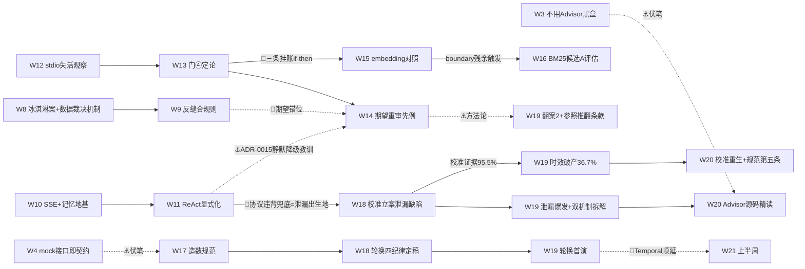

# 课程地图：W1-W22 全景串联（v2 导航版）

> 2026-10-20 编制（v2：导航性/能力坐标/证据枢纽/标签化/防腐化/因果边图六项升级）。
> 数据源头：各周计划与回顾文档原文 + 蓝图 [blueprint/README.md](blueprint/README.md)，
> 冲突时以周计划为准（蓝图 §0 口径）。
>
> **维护规则（防腐化，同构于黄金集轮换纪律）**：每周收官时在本表加一行并刷新"当前位置"
> 与"决策触发点"状态，挂进周记 15 分钟机制；超过两周未更新视为失效，重读各周计划重建。
>
> **关系标签**：←承 = 输入来自哪周 ｜ →启 = 输出供给哪周 ｜ ⚓伏笔 = 当时无意、后世兑现 ｜
> 📌挂账 = 未决项的流向 ｜ **能力层** = 蓝图 §3 知识点坐标（L0-L4 × 会用/会调/会造）。

## 一句话主线 与 当前位置

**从"能跑"到"可信"**：W1-5 把系统立起来（地基→模型→RAG→Prompt→工具），W6-9 让它
安全可测（协议→安全→评估→验收），W10-13 让它自己转（记忆→Loop→双向凭证→检索攻坚），
W14-19 把"可信"做成体系（复盘清账→检索收尾→评估造数→轮换首演）。

**当前位置：W24 ✅ 刚收官（零召回防线翻默认 + judge 拒答口径对齐 + 反馈回路最小环 + 挂账清仓）→ W25 ▶ 待立案**
（bm25 重评 / 阈值悬崖治本 / 候选区造数转正 / HITL 真实样本观察，提案待 Owner 拍板）。

## 跨周因果边图（只画非线性边——线性时间链见下表）

## 逐周串联

### M1 地基与单次交互（W1-5）：把系统立起来

| 周 | 关注点 | 解决什么问题 | 关系 | 能力层 | 证据 |
|---|---|---|---|---|---|
| W1 | 工程地基：AGENTS.md、技术栈 ADR、CI、K8s 清单 | 从零建干净实验田，云原生第一天 | →启：一切的基座；📌真源/选型/Token 账→W4/W5 | 横切（可观测性） | [计划](m1/w1-foundation.md) |
| W2 | DeepSeek 接入、配置分层、对话测试页 | stub→真实模型；密钥管理与文档暴露面立规 | ←承 W1；📌L1 跳层→W4 补课触发器 | L1.1 起步 | [回顾](m1/w2-real-model.md) |
| W3 | RAG 全链路：Qdrant、幂等摄入、手动编排、引用+硬拒答、eval 雏形 6 条 | L2 检索落地；红线 01/03 进代码结构；"假阳性冒烟"教训 | →启：黄金集雏形→W5；⚓不用 Advisor 黑盒→W20 源码专项 | L2.2/2.3 会造、L2.5 起步 | [回顾](m1/w3-rag.md) |
| W4 | L1 补课：StockDataClient mock 先行、prompt 版本化、P0 结构化输出、选型+Token 账 | "禁止跳层"铁律纠偏；prompt 从字符串变资产 | ⚓接口即契约→W17 零改动换真源；⚓few-shot 隔离→W17 防泄漏 | L1.1/1.5/1.6、L0.5 | [计划](m1/w4-l1-prompt-engineering.md) |
| W5 | 三 @Tool 上线、来源时点强制注入、黄金集 20 条过 M1 门 | "W4 手填的数据，W5 让模型自己取"；工具 Harness 雏形 | ←承 W4；→启：三工具→W6 协议化；M1 门通过才进 M2 | L3.2、L3.6 雏形 | [计划](m1/w5-function-calling.md) |

### M2 Harness+MCP+Eval（W6-9）：让它安全可测

| 周 | 关注点 | 解决什么问题 | 关系 | 能力层 | 证据 |
|---|---|---|---|---|---|
| W6 | MCP Server（Streamable HTTP）、统一入口+规则路由、traceId 串链 | 被真实客户端调通——M2 门① | ←承 W5 工具；📌协议另一半→W12 | L2.9（Server 半） | [补录](m2/w6-mcp-server.md) |
| W7 | 红队 10 用例、脱敏+入参上限、RedLineGuard、TokenUsageAdvisor | 对抗面建档立卡；"看得见"先行 | →启：为 W8"拦得住"铺语义；token 账→W8 一页账 | L3.10、L3.4、横切成本 | [补录](m2/w7-security-cost.md) |
| W8 | CVE fail-fast、manifest 增量摄入、黄金集 30-50、eval 三维、一页成本账 | eval 升级三维；**数据裁决机制首创**（few-shot A/B 命中才保留） | ⚓数据裁决=W13 起所有启用决策的母机制；📌冰淇淋案→W9→W14 | L1.8 起步、成本工程 | [计划](m2/w8-eval-hardening.md) |
| W9 | 缓冲+M2 验收：反缝合规则、架构图、M3 backlog 证据排序 | 收尾沉淀；M3 方向由证据不由喜好 | →启：M3 各周顺序在此拍板 | L3（规约层） | [计划](m2/w9-m2-acceptance.md) |

### M3 最小 Loop（W10-13）：让它自己转

| 周 | 关注点 | 解决什么问题 | 关系 | 能力层 | 证据 |
|---|---|---|---|---|---|
| W10 | 会话记忆（内存版）、SSE 流式 | A14 双盲区：多轮无记忆、整段等待 | →启：SSE=W11 轨迹通道；冒烟实锤指代证据#4→W11 改写器；📌记忆持久化→Temporal 包 | L2.6（L1 层） | [计划](m3/w10-react-loop.md) |
| W11 | ResearchLoop 显式化+协议解析+轨迹可观测、QueryRewriter、多轮 eval、CI 回归门 | 循环搬到明面：轨迹可见、步数可控；指代未消解咽喉打通 | ←承 W10 地基；📌协议违背兜底=泄漏出生地→W18→W19→W20；⚓ADR-0015 静默降级教训→W14 复盘 | L3.3 会调超出、L4.1/4.2 | [计划](m3/w11-query-rewrite-eval-gate.md) |
| W12 | MCP Client、API Key 默认拒绝、限流 429、模型 failover | 凭证双向；安全缺页补齐；单点故障消除 | ←承 W6 对偶；📌stdio 失活观察→W13 门④→W14 修复 | L2.9（Client 半）、L3.4/3.5 | [计划](m3/w12-mcp-client-auth.md) |
| W13 | 两阶段设计 ADR-0017、chunk-size 对照、混合检索 +21pp、rerank 裁决不启用、M3 验收 | 召回/精排分层——生产级检索范式；两个银弹被数据证伪 | →启：M3 欠账→W14；📌三条挂账 if-then→W15-16 | L2.4 会调（提前达成）、L2.1/2.5 | [计划](m3/w13-retrieval-two-stage.md)、[hybrid-eval](../eval/retrieval/w13-hybrid-eval.md) |

### 进阶期（W14-19）：把"可信"做成体系

| 周 | 关注点 | 解决什么问题 | 关系 | 能力层 | 证据 |
|---|---|---|---|---|---|
| W14 | 复盘文《13 周我误解过什么》+ 三欠账当周清 | 认知纠偏成文；"欠账不过周"立威；进阶期干净基线 | ←承 W13 门④+M3 欠账；⚓期望工程先例→W18/W19 翻案方法论 | L3.5 加固、评估方法论 | [计划](advanced/w14-retro-and-debt.md) |
| W15 | embedding 对照（bge-m3 vs Qwen3-8B）、指代改写取证、GraphRAG 认知 | 选型结论由自家黄金集产出，不抄榜单；boundary 残余归因到层 | ←承 W13 挂账；→启：boundary 残余触发 W16 候选 A | L2.1、L2.8 会用 | [计划](advanced/w15-embedding-compare.md)、[对照报告](../eval/retrieval/w15-embedding-comparison.md) |
| W16 | topScore 逐案采集、BM25 候选 A 取证评估 | 阈值 0.5 第一次有分布证据；挂账"累积再动手"收口 | ←承 W15 触发条件；→启：L2 收官→专项二 | L2.4 收尾 | [计划](advanced/w16-sparse-bm25-eval.md) |
| W17 | Tushare 真源（REST 直连裁决）、造数规范成文、检索集 39→60 | 主代码唯一 mock 挂账收口；评估样本量风险开工 | ←承 W4 接口契约兑现；→启：规范→W18 定稿→W19 首演 | L3.2 工具层、专项二 | [计划](advanced/w17-tushare-and-eval-data.md)、[v4 基线](../eval/retrieval/w17-golden-v4-baseline.md) |
| W18 | Judge 校准 95.5% 双盲全量、生成集 22→52、论述补章、轮换四纪律定稿 | 生成评估标尺补到同等可信度；"一致率≥80%"首次达标 | →启：泄漏立案→W19 爆发；95.5% 证据→W19 时效破产对照组 | L1.8 会调超出、专项二 | [计划](advanced/w18-eval-data-week2.md)、[校准报告](../eval/generation/w18-judge-calibration.md) |
| W19 | 轮换首演：5 PDF 入库、检索 v5 94.3%、生成 v3 零能力回归、校准 36.7% 破产登记 | 四纪律从条文变实证；"旧库不可答→新库可答"双侧成立 | ←承 W18 四纪律；→启：泄漏双机制/校准重生/规范第五条→W20 全部输入；📌Temporal→W21 | L0.4 实战、专项二收尾 | [计划](advanced/w19-rotation-first-run.md)、[验收报告](../eval/w19-rotation-first-run-review.md) |
| W20 | 协议泄漏双机制修复（prompt 纪律+parser 容错+MAX_STEPS 合成步）、校准复测 63.3% 立案、Advisor 链源码精读成文 | 泄漏要修双机制（出口纪律+兜底防线）；校准证据有时效，语料一变即复测 | ←承 W19 立案全部输入；→启：judge 处置（输入侧注入）→W21；📌Temporal 再顺延（裁决②）；⚓W3 不用黑盒伏笔回收 | §3A L1 ⚠️ 项回收（ChatClient 会造） | [计划](advanced/w20-leak-fix-and-advisor-source.md)、[复测揭盲](../eval/generation/w20-calibration-rerun.md) |
| W21 | Temporal 三件套（最小环/loop run 持久化裁决/记忆 L2 MySQL/ADR-0019）、judge 输入侧处置复测 83.3% 过线、L4 设计先行（三角色边界+Skill 测量守线） | 顺延包完成定义后滑两次即封顶；修 judge 先动输入侧、尺冻结（隔离变量精神延续） | ←承 W19/W20 两次裁决；→启：三角色设计→W22 动工；📌案05 golden 口径+红线批观察→W22 #3 | L4.4/4.5 设计档、L2 记忆持久化 | [计划](advanced/w21-temporal-and-l4-kickoff.md)、[复测 r2](../eval/generation/w21-calibration-rerun-r2.md)、[L4 设计](advanced/w21-l4-subagent-and-skill-design.md) |
| W22 | 三角色管线动工→57 案双臂验收 +0.33/红线 14/14→切默认引擎；Skill 机制+Token 实测 2.0%<20% 止步；挂账清零（检索多样性归因/judge 修尺复评/401 销项） | 职责切分兑现 compound +0.82 抬头；未达守线就止步不硬上；修尺必须带对照案复评（涉案翻分、满分案不动） | ←承 W21 设计；→启：HITL 接通+检索主体配额+A2A 认知→W23；⚓A17 汇报语言纪律入规（Owner 指令） | L4.4/4.5 会调落地 | [计划](advanced/w22-l4-subagent-pipeline-and-skill.md)、[双臂验收](../eval/generation/w22-pipeline-dual-arm.md)、[Skill 实测](../eval/generation/w22-skill-token-report.md) |
| W23 | HITL 审批断点接通（裁决①B 打回耗尽升级人工：挂起→放行/驳回/超时 fail-closed，双路径真机演示，三处留痕）；检索主体多样性修复（词典识别+配额重排+锚定补召，涉案案 buckets[0,20]→[2,20]、回归 94.3% 达标翻默认）；Skill 扩列 4 个+双臂重测 9.7%<20% 再止步；A2A「会用」档+L4 全项验收 | HITL 缺席策略必须显式化；零召回硬拒答与 judge「无理由拒答」口径摩擦登记 backlog；重测的第二使命=归因分离（库太小 vs 注入点） | ←承 W22 预埋 Signal/多样性病灶；→启：W24 待立案（零召回重试/分词加固、HITL 翻默认裁决、refusal-boundary 触发缺口） | L4.4/4.5 会调完整、A2A 会用 | [计划](advanced/w23-hitl-and-retrieval-diversity.md)、[HITL 演示](../eval/generation/w23-hitl-demo.md)、[多样性收官](../eval/retrieval/w23-diversity-quota.md)、[Skill 复测](../eval/generation/w23-skill-token-report-r2.md)、[L4 验收](../eval/generation/w23-l4-acceptance.md)、[A2A 笔记](../notes/a2a-protocol.md) |
| W24 | 零召回防线：根因坐实为 dense 阈值悬崖（涉案案 top 0.4817 惜败 0.5，分词假设作废），重述重试机制 A/B 活探针 关=3/3 拒答/开=3/3 救回 达标翻默认 true；judge 拒答口径对齐（检索信号注入，rubric 冻结，涉案案 compliance 0→2、满分案不动）；人工反馈回路最小环（👍/👎→badcase 登记→人工裁定→候选区，真实 badcase 694fcbe6 走通）；挂账清仓（HITL 翻默认 true + Tushare hosted MCP 体验销项，258 工具） | 证据归因必须落到机制本身——批次翻分若是措辞运气就明说，不记功；反馈入黄金集必过人（裁决②A）；修尺证据范式复用第三次仍成立 | ←承 W23 backlog 全部输入；→启：W25 待立案（bm25 重评：sparse 长问句零产出、阈值悬崖治本、候选区造数转正、HITL 真实样本观察） | 反馈回路 L2 最小环落地 | [计划](advanced/w24-recall-robustness-and-feedback-loop.md)、[零召回收官](../eval/retrieval/w24-zero-recall-retry.md)、[judge 复评](../eval/generation/w24-judge-rescore-2.json)、[MCP 笔记](../notes/tushare-hosted-mcp.md) |

## 决策触发点清单（导航核心：预先写死的 if-then 及其状态）

| 触发条件 | 写在 | 状态 |
|---|---|---|
| M1 门 Recall@5 ≥0.7，不过不进 W6 | W5 计划 | ✅ 已过（W5） |
| 混合检索 ≥5pp 才默认启用，否则默认关 | W13 #2 | ✅ 触发启用（+21pp） |
| rerank 有提升才启用 | W13 #3 | ✅ 裁决不启用（+0pp）；📌重评条件=召回格局变化，W16 判定未触发 |
| boundary 残余失败→重启 BM25 候选 A 评估 | W15 计划 | ✅ 触发并执行（W16） |
| 轮换窗口：2025 年报+2026 半年报入库→首演 | W18 #4 | ✅ 已首演（W19） |
| 校准证据在语料/缺陷状态变化后必须复测 | W19 #4 报告（规范第五条候选） | ✅ W20 复测立案 → W21 处置复测 83.3% 过线 → W22 accuracy 修尺+复评 |
| judge 分可信度恢复前提：泄漏修复+校准复测达标 | W19 #4 报告 | ✅ 已过（W20 修复 + W21 复测达标） |
| Temporal 三件套顺延 W21，W24-27 缓冲吸收 | W19 裁决①/W20 裁决② | ✅ 已交付（W21 #1 三件套 + ADR-0019） |
| Skill 注入模式实测 ≥20% 降幅才启用，否则保持 off | W22 #2 测量守线 | ✅ 实测 2.0% 未达线 → 止步登记，默认 off |
| 落后 ≤3 天挤缓冲；1 周砍 Temporal；严重砍 P3 保底线 | 蓝图 §7 降级原则 | 备用，未触发 |
| 流量驱动裁决项（语义缓存/上下文压缩/反馈回路/记忆 L3-L5） | 进阶期索引 | ⏸ W24-27 前按流量数据裁决 |

## 四条贯穿暗线（横着看这张地图）

1. **评估线**：W3 雏形 6 条 → W5 二十条过门 → W8 三维+数据裁决 → W11 多轮+CI 门 →
   W17-18 造数专项（规范/校准/扩容）→ W19 轮换首演+校准时效破产 → W20 复测立案 →
   W21 输入侧处置达标（83.3%）→ W22 accuracy 修尺+对照复评。
   主线教训：**评估设施本身的可信度也要被评估**（judge 校准、期望重审、参照推翻）。
2. **检索线**：W3 纯向量 → W13 混合检索+两阶段（+21pp）→ W15-16 对照收尾 →
   W19 语料 3→8 源的挤压效应。每个"银弹"都被自己的黄金集数据裁决过。
3. **数据真源线**：W4 mock 先行（接口即契约）→ W17 Tushare 真源（开关切换）→
   W19 发现联动盲区（mock 种子未随轮换更新）——红线 03 的诚实标签让假数据永远藏不住。
4. **协议/安全线**：W6 Server → W12 Client+鉴权限流 → W11 协议显式化 →
   W19 协议违背降级爆发 → W20 修复。安全从 W7 起就是"看得见→拦得住"两步走。

## 下一站

W25（待立案）：W24 已收官——零召回防线（dense 阈值悬崖根因 + 重述重试 A/B 证据达标
翻默认）、judge 拒答口径对齐（检索信号注入，涉案案归位）、人工反馈回路最小环
（真实 badcase 走通登记→裁定→候选区）、挂账两件清仓（HITL 翻默认 true +
Tushare hosted MCP 258 工具销项）。W25 输入候选：bm25 路线重评（sparse 腿长问句
近零产出，W24 #1a 登记）、阈值悬崖治本（score 校准/自适应阈值，backlog）、
候选区造数按规范转正、HITL 翻默认后真实挂起样本一周观察。
