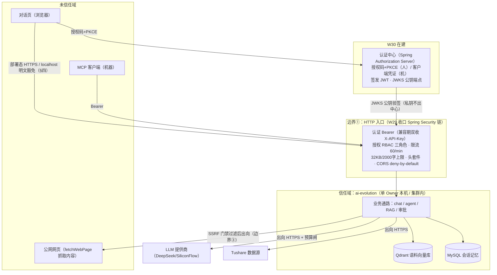

# 系统安全架构设计（W30 #0）：威胁建模总表 + 信任边界

> 2026-11-05 成文（W30 任务 #0，威胁建模先行）。定位：把散落于 W7-W29 的安全防线收成
> 一张架构总图——**资产 → 威胁 → 已有防线 → 缺口 → 处置**，防线归位全部挂证据链接。
> 维护规则：新增防线或新暴露面当周更新本表（节奏同 A8 周级闸门）；超过两周未与代码
> 对齐视为失效。术语：威胁建模 = 先盘点「保护什么、谁会攻击、现有防线在哪」再决定
> 补什么的方法论；OWASP LLM Top10 = 业界对 LLM 应用最常见十类攻击面的共识清单。

## 一、信任边界图

## 二、总表：资产 → 威胁 → 已有防线 → 缺口与处置

| 资产 | 威胁 | 已有防线（证据） | 缺口与处置 |
|---|---|---|---|
| 合规红线（禁买卖建议/目标价） | 直接/间接注入诱导模型越线 | system prompt 红线 + 服务端敏感模式告警（[ADR-0011](../adr/0011-redline-alert-only.md)）+ redline 黄金集 7 案常驻监考 + judge compliance 维；W7 红队 A1/A2/I1/I2 守住（[基线](w7-redteam-baseline.md)） | 防线偏软（模型自觉为主）；多轮渐进渗透仅 1 案监考 → **挂账**：扩充多轮 redline 案；L1 moderation 触发条件在案（[W18 论述](moderation-minimal-defense.md)） |
| LLM 预算（token 成本） | 无界消耗/成本攻击（W7 M3 实证：超长参数直达上游付费 API） | 入参上限（W7 P0 修复）+ 限流 60/min + 32KB/2000 字双层上限（W28 #3）+ 日预算熔断 fail-closed + 运行时可调（W27 #4） | — 已闭环 |
| 身份凭证与访问控制 | 未授权访问 / 越权 | W12 默认拒绝 → W29 收口 Spring Security 链 + RBAC 三角色 + 401/403 分清 + 无状态会话（[ADR-0022](../adr/0022-spring-security-rbac-bearer.md)，[红队复测](w29-redteam-recheck.md) 9 项守住） | Bearer 当前为 opaque 共享 key，无个体身份与吊销语义 → **本周做**（W30 #1-#3） |
| 注册端点（W30 #6 新增，系统首个无凭证入口） | 批量注册 / 账号枚举 / 密码喷洒 | 注册即 pending 默认拒绝 + HITL 审批激活（复用 W23 设施）+ 端点限流 + argon2 哈希落库明文不过夜 | 随 #6 本周落地 |
| MCP 协议面 | 堆栈泄漏 / 畸形协议 / 未知方法 | W7 M1 修复（错误脱敏）+ W29 认证先于协议解析（R8/R9 复测守住不回归） | — 已闭环 |
| 系统上下文 | 外部网页内容间接注入（fetchWebPage 引入未信任输入） | 出向白名单先例（[ADR-0016](../adr/0016-mcp-client-fetch-whitelist.md)）+ W29 SSRF 门禁（内网/回环/组播拒连、fail-closed）+ 架构上标记为未信任输入 | DNS rebinding TOCTOU 窗口（守卫与 fetch 真实解析之间存在时间差） → **挂账**：egress 代理统一出向；触发条件=多副本/对外服务化 |
| 浏览器会话面 | XSS / 点击劫持 / 跨域滥用 | W29 头套件（CSP/X-Frame-Options/nosniff/Referrer-Policy）+ CORS deny-by-default 白名单 | CSP `unsafe-inline` 为过渡态 → **挂账**：对话页内联脚本抽外置后收紧（代码注释在案） |
| 对话数据与会话记忆 | 隐私泄露 | 单租户本地 MySQL + RBAC 保护端点 | 存储无加密 at-rest → **挂账**；触发条件=多租户/共享主机 |
| 语料库（Qdrant） | 向量库投毒 | 可信语料（两家年报公开披露文档，无 UGC/爬取/上传）+ 摄入来源管控架构约束（W7 P2） | 无内容审查管线 → **登记触发条件**：开放上传/UGC 即重启（W18 已立） |
| API 密钥 ×3（DeepSeek/SiliconFlow/Tushare） | 泄漏被盗用产生账单 | 12-factor 环境变量注入、`.env` 不入库（A5） | k8s Secret 仅 base64 非加密 → **挂账**：生产级=外部密管（Vault/KMS 类）；触发条件=真实部署 |
| 传输链路 | Bearer token 明文 HTTP 被窃听 | localhost 同机信任边界豁免（§四声明） | 部署态无 TLS → **本周做**（W30 #5：声明 + 视容量 ingress TLS） |
| 依赖供应链 | 依赖 CVE 被利用 | O5 最新稳定版纪律 + CVE-2026-59318 fail-fast 显式配置先例（[ADR-0013](../adr/0013-explicit-security-config-with-test-lock.md)） | 无 SBOM/自动依赖扫描 → **挂账**；触发条件=对外发布，CI 加 dependency-check |
| 模型输出可信度 | 幻觉/编造数字 | 红线 03 数字必溯源 + judge accuracy 维 + 生成黄金集 58 案巡检 + W22 修尺 | — 已闭环 |
| 操作副作用面 | Agent 过度代理执行高危操作 | 工具集全只读（行情/财务/公告/网页抓取）+ 工具调用次数上限 + HITL 审批闸（W23） | — 已闭环 |

## 三、OWASP LLM Top10 逐项对账（2025 版）

| 项 | 结论 | 证据 / 处置 |
|---|---|---|
| LLM01 提示注入 | ✅ 多层防线 | W7 红队 A1-A4/I1-I2 + 红线三件套 + 黄金集监考（补强路径=多轮案扩充，挂账） |
| LLM02 敏感信息泄露 | ✅ 归位溯源标注 | A3/A4 守住；MCP 错误脱敏（W7 P0 修复）；数字必溯源（红线 03） |
| LLM03 供应链 | ⚠️ 部分 | 见缺口登记：SBOM/自动扫描挂账，触发条件=对外发布 |
| LLM04 数据与模型投毒 | ✅ 登记触发条件 | 语料低风险成立；开放上传/UGC 即重启（W7 P2 + W18） |
| LLM05 输出处理不当 | ✅ | 免责声明单点追加（A12）；CSP 头套件收敛渲染面（W29） |
| LLM06 过度代理 | ✅ | 只读工具集 + 次数上限 + HITL 审批（W23） |
| LLM07 系统提示泄露 | ✅ 防线位置诚实登记 | A3 守住；防线=模型自觉 + 告警，不夸大强度；补强=L1 moderation（触发条件在案） |
| LLM08 向量与嵌入弱点 | ✅ 登记 | 元数据三件套过滤 + 红队隔离 collection 先例；Qdrant 无独立 ACL → 集群内信任边界登记（§四边界④） |
| LLM09 误导信息 | ✅ | 数字必溯源 + judge accuracy + W22 修尺复评 |
| LLM10 无界消耗 | ✅ | 入参/请求体/消息三层上限 + 限流 + 预算熔断 fail-closed + 运行时可调 |

## 四、信任边界声明（含 TLS localhost 豁免）

- **边界①（浏览器/MCP → HTTP 入口）**：当前唯一部署形态为 Owner 本机 localhost——
  浏览器与本机进程同处一台机器的信任边界内，明文 HTTP 不离开网卡，威胁模型接受此豁免。
  **Bearer token 跑跨机器明文 HTTP 等于没认证**：任何跨机器部署必须先落 TLS（ingress
  终结），落地见 W30 #5。
- **边界②（出向 LLM/Tushare）**：HTTPS + 密钥环境变量注入（A5），预算闸兜底异常消耗。
- **边界③（fetchWebPage 出向）**：SSRF 门禁 + 抓取内容在架构上标记为未信任输入
  （间接注入面，W7 I1/I2 与 W18 论述在案）；已知边界=DNS rebinding TOCTOU，生产级
  处置为 egress 代理统一出向。
- **边界④（集群内存储 Qdrant/MySQL）**：无独立 ACL——单 Owner 单租户接受；
  多租户化或对外开放任一成立即重评。
- **边界⑤（W30 新增：认证中心 → 资源服务器）**：JWKS 公钥验签，签名私钥永不出认证
  中心；ai-evolution 只验票不认证，认证逻辑从业务系统剥离。

## 五、缺口处置登记（ actionable 清单）

**本周做（W30 内）**：

| 缺口 | 落位任务 |
|---|---|
| 无个体身份/令牌吊销语义（opaque 共享 key） | #1-#3 认证中心 + 资源服务器改造 + 对话页登录流 |
| 部署态 TLS 缺失 | #5（声明不降级；落地可降级为 backlog 登记） |
| X-API-Key 兼容期收尾 | #2（退役或续期裁决，登记 ADR） |
| 注册端点开放面防护（pending + 审批 + 限流） | #6 |

**挂账（触发条件显式化，任一成立即重启）**：

| 缺口 | 触发条件 |
|---|---|
| 多轮 redline 监考案仅 1 案 | 下次 badcase 裁定台会议批量扩充 |
| L1/L2 moderation 审核层 | UGC/对外开放/外部工具面扩大/监管要求（W18 四条件） |
| DNS rebinding → egress 代理 | 多副本或对外服务化 |
| CSP unsafe-inline 收紧 | 对话页内联脚本抽外置（前端改造时顺带） |
| 对话数据 at-rest 加密 | 多租户/共享主机 |
| 外部密管（k8s Secret 仅 base64） | 真实部署 |
| SBOM/依赖自动扫描 | 对外发布 |
| 密钥轮转规程 + 安全事件审计流 | 已裁决顺延 W31（随韧性捆合并） |
